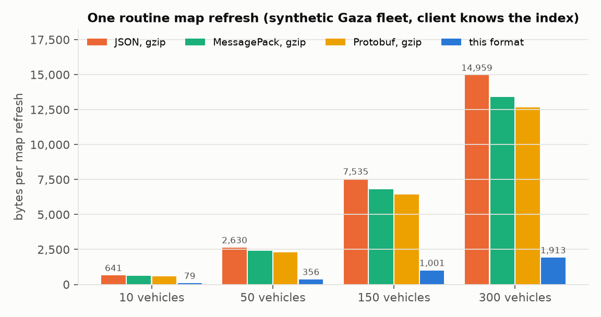
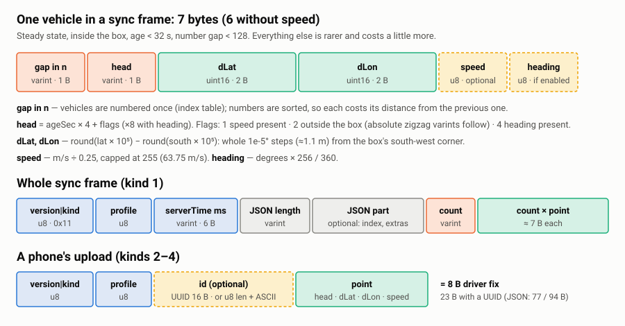

# gaza-geo-sync

**Live map positions in ~7 bytes per vehicle — with a JSON fallback, offline-cache friendly, built for the weakest mobile data.**

A small TypeScript template/library for syncing live positions (vehicles, couriers, field teams, a rider
sharing their location) between a server and a web or mobile client. It was built in Gaza for a
transport app used on 2G/EDGE mobile data and crowded Wi-Fi, and it is published here so anyone
building for low-bandwidth users can use it.

- **~7.4× smaller** map refreshes than gzip'd JSON on a synthetic Gaza fleet (356 B vs 2,630 B for 50 vehicles; 1,913 B vs 14,959 B for 300).
- **8-byte** GPS uploads (JSON: 77 B), and **~4× fewer upload requests** while a vehicle is parked.
- **JSON stays the default.** Binary only when the client asks (`Accept`), so old clients, curl and debugging keep working.
- **Same records either way**: the client decodes on arrival, so your offline cache and screens do not change.
- **Strict decoder**: bounds-checked, refuses trailing bytes, fuzz-tested; only ever throws `CodecError`.
- **Zero runtime dependencies.** MIT. Includes Claude Code skills and copy-paste templates.

<p align="center"></p>

> Research write-up: **[paper (PDF)](paper/gaza-geo-sync.pdf)** · [paper source](paper/paper.md) ·
> [design notes](docs/RESEARCH.md) · [test report](docs/TEST-REPORT.md) · [migration guide](docs/MIGRATION.md) ·
> [used in Mishwar](docs/USED-IN.md) · [built in Gaza](docs/BUILT-IN-GAZA.md)

---

## Why

A live map polls every 30 seconds for the position of every vehicle. In JSON one position looks like
`{"id":"cm1x4k2ab0003npyq8vi3ojyf","lat":31.51234567891234,"lon":34.45678912345678,"speed":8.33,"at":"2026-10-06T07:59:41.512Z"}` —
and gzip barely helps, because random ids, float noise and per-vehicle timestamps do not repeat.
What really changed since the last refresh is a few metres and a few seconds. This format sends only that:

1. **Quantise** coordinates to 1e-5° (≈1.1 m, finer than phone GPS) as 2-byte offsets from the south-west corner of your area.
2. **Index, don't repeat**: each object gets a small number once; frames carry sorted gaps (1 byte).
3. **Ages, not timestamps**: whole seconds before the frame's server time (packed with flags in 1 byte).

Details, alternatives (MessagePack, CBOR, Protobuf, FlatBuffers) and **where binary does not win**: [docs/RESEARCH.md](docs/RESEARCH.md).

## Two kinds of connectivity: Wi-Fi and the weakest mobile data

The same client works on both, and degrades gracefully between them:

| | on Wi-Fi | on 2G/EDGE-class mobile data (high latency, low bandwidth, loss) |
|---|---|---|
| **fewer bytes** | saves data; little time difference | less airtime and fewer TCP round trips — the map updates sooner on big fleets |
| **fewer requests** (standing-still throttle) | fewer requests | ~4× fewer uploads while parked: fewer radio wake-ups, fewer chances to time out |
| **204 for uploads** | — | no response body to wait for |
| **offline cache** | — | the map shows the last good copy when a refresh fails |
| **JSON fallback** | old clients fine | old clients fine |

Measured in headless Chromium behind Linux `tc-netem` profiles (Wi-Fi, 4G, 3G, EDGE, 3G with 3% loss):

| profile | 50 vehicles: JSON → binary (median ms) | 300 vehicles: JSON → binary (median ms) | p90 at 300 | bytes per refresh at 300 (wire) |
|---|---:|---:|---:|---:|
| Wi-Fi | 32 → 31 | 37 → **35** | 45 → 42 | 11,576 → 2,628 |
| 4G | 183 → 182 | 193 → **188** | 198 → 195 | 11,588 → 2,773 |
| 3G | 324 → 314 | 371 → **326** | 371 → 327 | 11,644 → 2,933 |
| EDGE (2G) | 943 → 889 | 1,261 → **959** | 1,263 → 960 | 11,724 → 3,020 |
| 3G + 3% loss | 323 → 315 | 372 → **326** | 943 → 372 | 11,778 → 3,089 |

<sub>Synthetic fleet, 40 refreshes per cell, headless Chromium 153 with 4× CPU throttle, HTTP/1.1. Bytes include HTTP headers both ways. Full method and every run: [docs/TEST-REPORT.md](docs/TEST-REPORT.md).</sub>

Honest limits: on high-latency links a small refresh takes one round trip whatever its format, so time
saved appears only once the JSON is big enough to need extra round trips (see the table); and for small
uploads HTTP headers outweigh the body, so the win there is fewer requests, not smaller ones.

<p align="center"></p>

## Quick start

```bash
npm install github:AQaddora/gaza-geo-sync     # builds on install; or vendor src/*.ts (zero deps)
```

**One shared codec** (server and client import the same file):

```ts
import { createCodec } from "gaza-geo-sync";
export const codec = createCodec({ south: 31.2, west: 34.2 }); // your area's south-west corner
```

**Server** (Next.js App Router shown; Express adapter included):

```ts
import { IndexTable } from "gaza-geo-sync";
import { positionsReply, toFetchResponse } from "gaza-geo-sync/server";

export async function GET(request: Request) {
  const live = await db.livePositions();            // [{ id, n, lat, lon, speed, at }]
  const table = new IndexTable(live.map((v) => [v.n, v.id]));
  return toFetchResponse(positionsReply({
    codec, table, positions: live,
    accept: request.headers.get("accept"),           // JSON unless the client asks for binary
    acceptEncoding: request.headers.get("accept-encoding"),
    index: new URL(request.url).searchParams.has("since") ? undefined : table.entries(),
  }));
}
```

**Client**:

```ts
import { fetchPositions } from "gaza-geo-sync";
const index = new Map<number, string>();             // persist it next to your cache
const { payload, unknown } = await fetchPositions("/api/positions", { codec, idOf: (n) => index.get(n) });
for (const [n, id] of payload.index ?? []) index.set(n, id);
draw(payload.positions);                             // [{ id, lat, lon, speed?, at }] — same as the JSON form
```

**A phone sending its point** (binary first, JSON if the server refuses; skips while standing still):

```ts
import { createPointSender } from "gaza-geo-sync";
const sender = createPointSender({ url: "/api/position", codec });
navigator.geolocation.watchPosition((p) =>
  sender.offer({ lat: p.coords.latitude, lon: p.coords.longitude, speed: p.coords.speed, fixAt: p.timestamp }));
```

Ready-made files: [`templates/`](templates) — Next.js route handlers, Express server, React hooks
(`useLivePositions`, `usePointSender`), service-worker notes.

## Converting your existing sync

Step by step, keeping JSON working at every step: **[docs/MIGRATION.md](docs/MIGRATION.md)**.
In short: measure → round coordinates (free 30%) → add a stable small number per object
(`seq SERIAL UNIQUE`) → wrap the route with `positionsReply` → replace `res.json()` with
`fetchPositions` → bump the client cache version once → measure again.

## Using it with Claude Code

This repo ships three [Claude Code skills](https://docs.claude.com/en/docs/claude-code/skills) so an agent
can learn the technique and apply it to your project:

| skill | what it does |
|---|---|
| `binary-sync-integrate` | adds the codec, routes, client hook and service-worker rules to a project |
| `binary-sync-migrate` | converts an existing JSON positions/sync endpoint, step by step, keeping the fallback |
| `binary-sync-verify` | proves it: round-trip and fuzz tests, bytes before/after, requests per minute, honest report |

Install them into your project (or into `~/.claude/skills` for all projects):

```bash
git clone --depth 1 https://github.com/AQaddora/gaza-geo-sync /tmp/gaza-geo-sync
mkdir -p .claude/skills && cp -r /tmp/gaza-geo-sync/.claude/skills/binary-sync-* .claude/skills/
cp -r /tmp/gaza-geo-sync/templates ./templates/gaza-geo-sync     # optional: the templates the skills refer to
```

Then ask Claude Code: *"use binary-sync-migrate on our /api/vehicles endpoint"*, or simply
*"make our live map use less mobile data"*. The repo's own [`CLAUDE.md`](CLAUDE.md) explains its layout
and rules to an agent working on this codebase.

## Byte layout

<p align="center"></p>

```
header   u8 (version << 4 | kind) · u8 profile
point    varint head = ageSec·4 + flags (·8 with heading)   flags: 1 speed · 2 outside box · 4 heading
         inside: uint16 dLat · uint16 dLon      outside: zigzag lat · zigzag lon (absolute units)
         [u8 speed / speedStep] [u8 heading·256/360]
frame    header(kind 1) · varint serverTimeMs · varint jsonLen · JSON · varint count · count × (varint gap · point)
upload   header(kind 2) · point  |  kind 3: 16-byte UUID · point  |  kind 4: u8 len · ASCII id · point
```

## Options

```ts
createCodec({
  south, west,        // origin (degrees): the south-west corner of the area most points fall in
  scale: 1e5,         // units per degree: 1e5 ≈ 1.1 m, 1e4 ≈ 11 m
  offsetBytes: 2,     // 2 → box ≈ 0.655° per side at 1e5; 3 → ≈ 168°
  speedStep: 0.25,    // m/s per step (0–63.75 m/s); 0 = no speed
  heading: false,     // +1 byte per point when true
  profile: 0,         // 0–255 in every header; decoders refuse other profiles — bump it when options change
});
```

## Tests and benchmarks

```bash
npm test         # typecheck + 28 tests: unit, round-trip, configuration, negotiation, client fallback,
                 # fuzz (2 × 2,000 random frames round-trip; 20,000 mutated/random inputs only throw CodecError)
npm run bench    # sizes vs JSON/MessagePack/CBOR/Protobuf, decode CPU, upload requests (synthetic data)
bench/sim/run-all.sh 40 30 && python3 bench/analyze.py   # browser + tc-netem simulation (Linux, sudo)
```

All benchmark data is **synthetic** (seeded generator along the Gaza Strip's main axis; no real people,
vehicles or trips). Full environment, profiles and raw CSVs: [docs/TEST-REPORT.md](docs/TEST-REPORT.md).

## Used in Mishwar

First built for **Mishwar**, a Gaza transport app (shared rides: *ajala* minivans, buses, cars). There it took
the guest map refresh from **2,120 B to 584 B** and a driver's point from **37–60 B to 7 B**, and a parked
driver from 4.3 to 0.9 uploads per minute. Screenshots (seeded demo data) and the full before/after: [docs/USED-IN.md](docs/USED-IN.md).

<p align="center">


</p>

## Built in Gaza

Developers in Gaza build for a network most of the world has left behind: for years mobile operators there
have been limited to 2G (GSM/EDGE) ([World Bank, 2016](https://documents1.worldbank.org/curated/en/993031473856114803/pdf/104263-REVISED-title-a-little-different-WP-P150798-NOW-OUO-9.pdf)),
and Wi-Fi is often shared and intermittent. The habits that come from that — count every byte, every request,
and keep working offline — are useful everywhere. This repository is a contribution from Gaza's tech community
to anyone building for low-bandwidth users. More: [docs/BUILT-IN-GAZA.md](docs/BUILT-IN-GAZA.md).

## Contributing

Field reports from real weak networks are the most valuable contribution; ports (Kotlin, Swift, Python,
Go), adapters and Arabic translations are very welcome. See [CONTRIBUTING.md](CONTRIBUTING.md) and the
[Code of Conduct](CODE_OF_CONDUCT.md).

## Licence

MIT © 2026 Ahmed Qaddoura. See [LICENSE](LICENSE).
