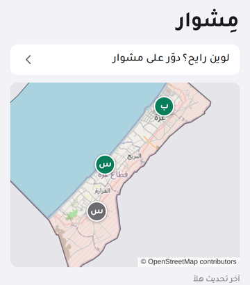
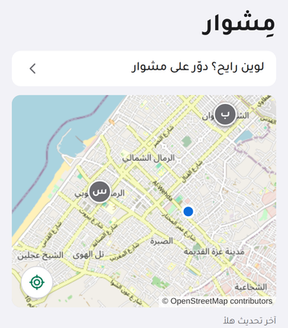
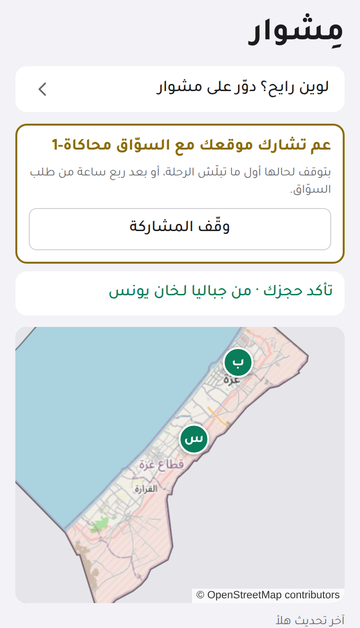
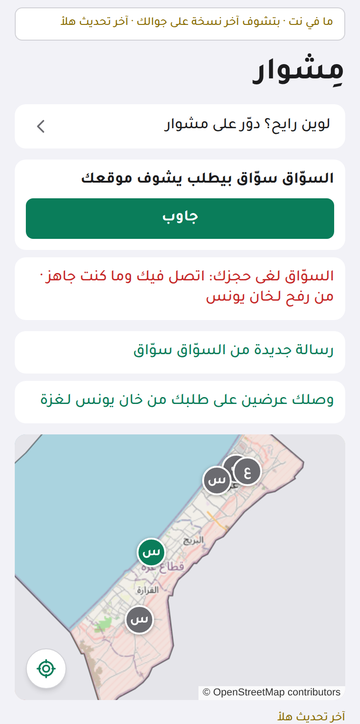

# Used in Mishwar, a Gaza transport app

This format was first built for **Mishwar** (مِشوار), a Gaza transport app (a PWA in Arabic) that
helps people find shared rides — the *ajala* minivans, buses and cars that carry most trips
along the Strip — see where vehicles are right now, book a seat and talk to the driver.
gaza-geo-sync is the generic, open-source version of the position sync written for it.

> The screenshots below come from Mishwar's automated test runs on **seeded demo data**
> (demo drivers, demo vehicles, demo photos, simulated GPS). They show where the format works
> inside a real app. Mishwar itself is not part of this repository.

## Where the binary format is used

| | | |
|:---:|:---:|:---:|
|  |  |  |
| **The live map.** Vehicle pins are refreshed every 30 s. The positions part of that sync is the binary frame: ~7 bytes per moving vehicle. | **The rider's own location** draws the map around them; vehicles nearby come from the same frame. | **The driver's screen** (أنا سايق, "I'm driving"). During a trip the phone sends its GPS point as 8 bytes, once a minute while standing still. |
|  |  | |
| **A rider sharing location** with the driver who is coming to pick them up: a 23-byte point carrying the share id as 16 raw bytes. | **Offline.** «ما في نت · بتشوف آخر نسخة على جوالك» — "No internet · you're seeing the last copy on your phone". Frames are decoded on arrival into the same records, so the offline copy works exactly as before. | |

## What it changed (measured in Mishwar)

Before/after, measured on production builds of the app in headless Chrome, 50 vehicles on the
road on real map stops; JSON gzipped as the app's web server sends it; steady state.

| | before (JSON) | after (binary) |
|---|---:|---:|
| Map routine sync, guest (2 per minute) | 2,120 B → 4.2 KB/min | **584 B** → 1.2 KB/min |
| Map routine sync, signed-in rider (bookings stay JSON) | 2,630 B | **1,105 B** |
| First sync (routes, vehicles, week) | 9,958 B | 8,584 B |
| Driver point, moving (~4.3/min) | 37–60 B body + 11 B answer | **7–8 B**, answered 204 |
| Driver point, parked | 4.3 per minute | **0.9 per minute** |
| Rider shared point, standing | 3/min × (73 B + 11 B) | **0.9/min × 24 B** |
| Sync unit test, 300 vehicles (gzipped) | 11,998 B | **2,050 B** |
| Decode, 50 vehicles, 6× CPU throttle (median) | 0.11 ms (`JSON.parse`) | 0.26 ms |

**Honest notes from that work**

- Decoding is about **2× the CPU** of the browser's native `JSON.parse` — 0.26 ms instead of 0.11 ms for
  50 vehicles on a 6× throttled CPU, 1.5 ms for 300. Nothing next to the network, but not free.
- For the two uploads, **HTTP headers (~800 B per request over HTTP/1.1 with cookies) dominate the body**.
  Going from 60 to 8 bytes of body barely moves the total; the real win there is **fewer requests
  while standing still**.
- Bookings, requests and chat stay JSON: they are diffed, text-heavy and compress well.
- This library differs slightly from Mishwar's in-app version: version and kind share one byte and a
  profile byte is added, so a driver point is the same 8 B and a shared point is 23 B instead of 24 B;
  the frame carries `serverTime` itself (6 bytes) instead of inside its JSON part.

## Why Gaza needed it

See [BUILT-IN-GAZA.md](BUILT-IN-GAZA.md): a city on 2G/EDGE mobile data and shared Wi-Fi, where a
map that wastes bytes is a map that does not load.
