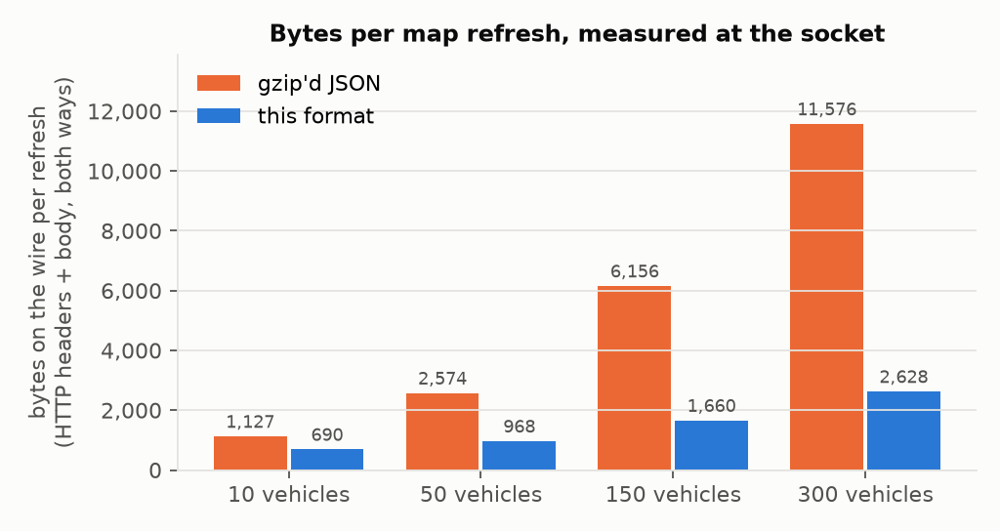
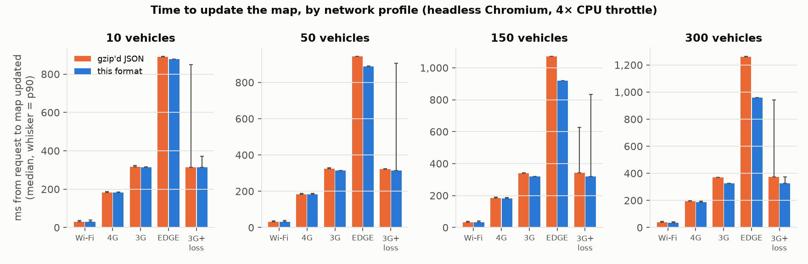
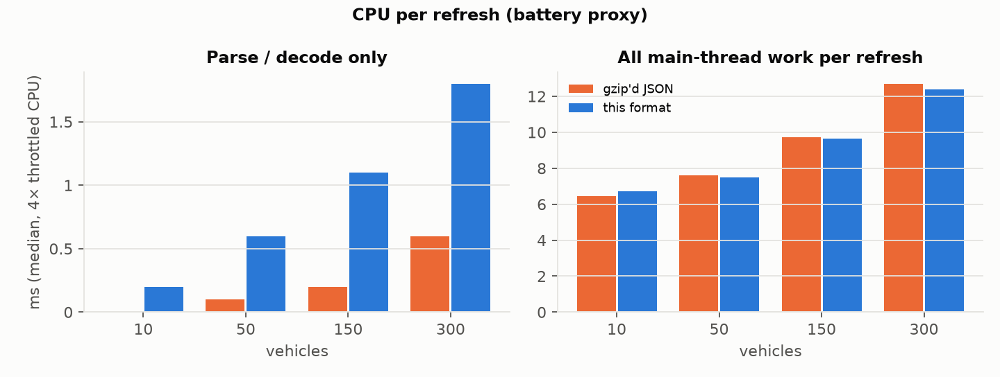
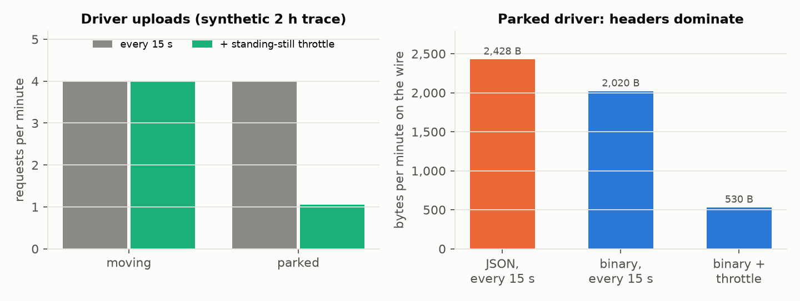

# Seven Bytes per Vehicle: Compact Binary Position Sync for Live Maps on Low-Bandwidth and Unstable Networks

**Ahmed Qaddoura**

Gaza · October 2026 · Source, data and tests: https://github.com/AQaddora/gaza-geo-sync

> **Abstract.** Live maps — shared transport, delivery, field logistics — poll a server every few seconds for the position of every tracked object. Encoded as JSON, one position costs 45–100 bytes even after gzip, because the parts that dominate it (random identifiers, floating-point noise, per-object timestamps) do not compress. On the 2G/EDGE-class mobile networks and congested shared Wi-Fi that many users in Gaza depend on, these bytes become airtime, round trips and battery. We present *gaza-geo-sync*, a small binary format and library built for a Gaza transport app, that encodes a moving vehicle in 7 bytes using three ideas: quantisation of coordinates to 1e-5° as 2-byte offsets from a regional origin, an index table that replaces identifiers with small sorted integers sent as gaps, and ages instead of timestamps packed with presence flags into one varint. The format is negotiated with HTTP content negotiation and falls back to JSON, and clients decode on arrival into the same records, so offline caches are unchanged. On a synthetic Gaza fleet, a routine refresh of 10–300 vehicles is 7.3–8.1× smaller than gzip'd JSON and 6.4–7.8× smaller than gzip'd MessagePack or Protobuf with a naive schema. In a browser simulation behind Linux tc-netem profiles from Wi-Fi to EDGE and a lossy 3G link, the binary format cut the bytes on the wire per refresh, HTTP headers included, by 39–77% (10–300 vehicles); on an EDGE-class link it reduced the median time to update a 300-vehicle map from 1.26 s to 0.96 s (−24%), while on Wi-Fi and 4G times were unchanged within a few milliseconds. Total main-thread CPU per refresh was equal within ±4%. We report where binary does not help: small uploads are dominated by HTTP headers, so the larger gain there comes from sending fewer requests, and JavaScript decoding costs more CPU than native `JSON.parse`.

## 1 Introduction

Applications that show moving things on a map share a simple loop: every *t* seconds the client asks for the current position of every object, and redraws. A shared-ride app in Gaza refreshes every 30 seconds while the map is open; drivers' phones upload their GPS position every 15 seconds while on a trip. The data is small, but it is sent all day, by every user, over whatever network is there.

In Gaza that network is weak. For most of the last two decades mobile operators in Gaza have been limited to 2G, with mobile data carried by EDGE, which the World Bank described as offering speeds "similar to fixed narrowband internet access" [19]. Wi-Fi, where available, is commonly shared by many users behind one uplink. Connections drop and return. Design for this environment is not an optimisation; it decides whether the map loads at all.

JSON is the default encoding for such APIs, and gzip is the default compression. Both are excellent for text. Positions are not text: a 25-character random id, two 15–17-digit floats and an ISO-8601 time per object are close to incompressible, so gzip leaves ~50 bytes per object (§5.1). Generic binary serialisations (MessagePack [1], CBOR [4], Protocol Buffers [2]) change the container but keep the content, and save little (§5.1).

This paper describes a format that changes the content: it sends only what a map needs, at the precision a phone's GPS can deliver, and only the part that changed meaning since the client last asked. Our contributions are:

1. A compact, versioned binary layout for live positions (7 bytes per moving object) with a strict, fuzz-tested decoder (§3).
2. An integration pattern that keeps JSON as the negotiated default and the cache format, so adoption is incremental and reversible (§4).
3. An evaluation on synthetic Gaza data across five network profiles from Wi-Fi to EDGE and a lossy link, measuring bytes, time-to-update, CPU and requests, with an explicit account of where the format does not help (§5, §6).
4. An open-source TypeScript implementation with templates and agent skills for integration and migration (§4).

## 2 Related work

**General-purpose binary serialisation.** MessagePack [1] and CBOR [4] encode JSON's data model in binary: integers and floats become fixed or variable-width binary, strings keep their bytes. Protocol Buffers [2] add a schema, field tags and LEB128 varints [9] with zigzag encoding for signed values; we use the same varint construction. FlatBuffers [3] and Cap'n Proto [5] trade size for zero-copy access with fixed-width, aligned fields. None of these address the redundancy specific to periodic position updates: identifiers repeated every refresh, coordinates with more digits than the sensor's accuracy, and absolute timestamps.

**Geometry and track encoding.** Google's Encoded Polyline Algorithm [6] quantises coordinates to 1e-5° and delta-encodes consecutive points of one line; Mapbox Vector Tiles [7] quantise to a tile grid and delta-encode geometry commands with zigzag varints; Geobuf [8] compresses GeoJSON using Protobuf, quantisation and deltas. These target geometry documents; we adopt their quantisation and integer coding but not their delta chains, since the objects in one frame are spatially unrelated (§3.2).

**Trajectory compression.** Line simplification (Douglas–Peucker [12]) and spatio-temporal variants for moving objects [13] reduce the number of points of a track. Our standing-still throttle (§3.5) is the simplest member of this family, applied online on the phone.

**Integer coding and header compression.** Fast integer codecs such as SIMD-based schemes [11] address decode throughput for billions of integers; at a few hundred integers per frame we favour a simple bounds-checked LEB128 reader. HTTP/2's HPACK [15] and HTTP/3 [16] replace repeated headers with indices into a shared table — the same idea as our index table, applied to identifiers.

**Energy.** Cellular radios remain in high-power states for seconds after each transfer ("tail energy"); measurements on 3G and LTE show that the number and spacing of transfers dominate energy for small payloads [17, 18]. This motivates reducing requests, not only bytes.

## 3 Design

### 3.1 Data model

A *position* is an object id, latitude, longitude, optional speed and heading, and the time of the GPS fix. The client keeps the latest position per object and draws it. A *sync frame* carries the positions of all objects on the road; an *upload* carries one phone's own position, optionally with an id (e.g. a location-sharing session).

### 3.2 Quantised coordinates with a regional origin

Coordinates are rounded to integer units of 1/*s* degree (default *s* = 10⁵, ≈1.1 m north–south, ≈0.95 m east–west at 31.5° N) — finer than consumer GPS. Each axis is stored as an unsigned offset from a configured origin, the south-west corner of the region most points fall in, in *B* bytes (default 2). With *s* = 10⁵ and *B* = 2 the box is 0.655° on each side (≈73 km × 62 km at Gaza's latitude), covering the 41 km Gaza Strip. Points outside the box remain valid: a flag selects absolute coordinates as zigzag varints. We considered delta coding between objects, but objects in a frame are spread over the whole region, so deltas are as large as offsets; delta coding against the client's previous copy would require server and client to agree on that copy, which is fragile when frames are lost.

### 3.3 Index table

Identifiers are the largest and least compressible part of a JSON position. Each object receives a small, stable integer *n* once (in practice a database `SERIAL` column), and the `[n, id]` pairs travel in the JSON part of a full sync. In a frame, positions are sorted by *n* and each carries only the gap from the previous number — usually 1 byte. A client that meets an unknown number drops that position, counts it, and requests a full sync next time.

### 3.4 Ages and flags in one varint

Each point begins with `head = age·F + flags`, where *age* is whole seconds before the frame's `serverTime`, *flags* mark speed present (1), outside the box (2) and heading present (4), and *F* is 4 (or 8 when headings are enabled). For ages under 32 s — the normal case for a 15–30 s update cycle — `head` fits in one byte. Speed is one byte in steps of 0.25 m/s (0–63.75 m/s); heading is one byte (≈1.4°).

### 3.5 Frames, uploads and the throttle

All messages begin with one byte holding the format version (high nibble) and kind (low nibble), and a *profile* byte that identifies the codec configuration; a decoder refuses other versions and profiles. A sync frame continues with `serverTime` (varint ms), a length-prefixed JSON part for any other response data, a count, and the points. An upload is a header and a point (8 bytes with speed); a UUID id adds its 16 raw bytes. The phone sends at most every 15 s, and only if it moved ≥ 15 m or 60 s have passed — the *standing-still throttle*.

```
point   varint head · uint16 dLat · uint16 dLon · [u8 speed] · [u8 heading]   = 6–8 B
frame   u8 ver|kind · u8 profile · varint serverTime · varint len · JSON · varint count · (varint gap · point)*
upload  u8 ver|kind · u8 profile · [16 B UUID | u8 len · ASCII] · point       = 8 B (23 B with UUID)
```

### 3.6 Strict decoding

The reader bounds-checks every read, caps varints at 8 bytes and lengths at fixed maxima, rejects repeated numbers, trailing bytes and coordinates outside ±90°/±180°, and throws a single error type. Malformed input therefore produces one predictable failure that the server maps to HTTP 400 — which is also the signal for an older client to fall back to JSON.

## 4 Usage: integration and migration

**Negotiation.** The client sends `Accept: application/octet-stream, application/json;q=0.5`. The server answers JSON unless binary is accepted, and sets `Vary: Accept, Accept-Encoding` [14]. Old clients, command-line tools and debugging continue to see JSON. Because proxies typically do not compress `application/octet-stream`, the server gzips a frame itself when that is smaller (first syncs with an index; rarely routine frames).

**Decode on arrival.** `fetchPositions` resolves to the same JSON record shape whichever format arrived. Offline caches (IndexedDB) therefore store identical records, and screens that read the cache are unchanged; only the `[n, id]` pairs are stored additionally. Bumping the client's cache schema once makes installed clients perform a full sync and learn every number.

**Uploads.** The server accepts binary or JSON bodies and answers binary uploads with 204 (no body). A client receiving 400 or 415 switches to JSON for the rest of the session. Positions are never queued offline: a stale point is worse than none.

**Migration** proceeds in independently shippable steps: measure; round JSON coordinates to 5 decimals (a free ≈30%); add a stable small integer per object; wrap the route with the negotiating helper; replace `response.json()` with the decoder; add the upload path; measure again. The repository includes route handlers (Next.js, Express), React hooks, service-worker guidance, and three Claude Code skills (*integrate*, *migrate*, *verify*) that encode these steps for coding agents.

## 5 Evaluation

All data is **synthetic**: a seeded generator places *N* vehicles along the Gaza Strip's main south-west–north-east axis with ±1.5 km of lateral jitter, a third of them parked, with raw-GPS-precision floats and 25-character random ids; each request advances moving vehicles by 15 s. No real user, vehicle or trip data is used. The JSON baseline in the simulation is the *favourable* one — coordinates already rounded to 5 decimals, gzip level 6 — so the reported gains are conservative relative to the naive JSON in §5.1.

### 5.1 Payload size

Table 1 compares one routine refresh (client already holds the index) across encodings (`bench/sizes.ts`). "Protobuf, tuned" applies this paper's quantisation, numbering and ages inside a Protobuf schema.

| vehicles | JSON | JSON gzip | JSON 5-dp gzip | MsgPack gzip | CBOR gzip | Protobuf gzip | Protobuf tuned | **this format** | JSON gzip ÷ this |
|---:|---:|---:|---:|---:|---:|---:|---:|---:|---:|
| 4 | 607 | 338 | 267 | 322 | 327 | 268 | 64 | **38** | 8.9× |
| 10 | 1,418 | 641 | 484 | 619 | 624 | 560 | 160 | **79** | 8.1× |
| 50 | 6,935 | 2,630 | 1,846 | 2,419 | 2,438 | 2,280 | 778 | **356** | 7.4× |
| 100 | 13,554 | 4,987 | 3,488 | 4,569 | 4,609 | 4,311 | 1,548 | **680** | 7.3× |
| 150 | 20,410 | 7,535 | 5,153 | 6,807 | 6,861 | 6,423 | 2,270 | **1,001** | 7.5× |
| 300 | 40,903 | 14,959 | 10,098 | 13,413 | 13,508 | 12,641 | 4,601 | **1,913** | 7.8× |

*Table 1. Bytes for one routine refresh (synthetic Gaza fleet; gzip level 6).*


*Figure 1. Bytes per routine map refresh by encoding and fleet size (synthetic).*

After gzip, MessagePack and CBOR save 3–10% over JSON and naive Protobuf 13–21%. The format is 7.3–8.9× smaller than gzip'd JSON, at 6.9–7.0 bytes per vehicle. Rounding JSON coordinates alone saves ≈30%. Protobuf with the same ideas comes within 1.7–2.4× of the format; the remainder is field tags and per-message length prefixes. The ideas, not the container, carry most of the gain. The first sync of a client carries the index (`[n, id]` pairs) and is larger; it is gzip-compressed and paid once per install or schema change.

### 5.2 Browser simulation across network profiles

**Setup.** A Node.js server and headless Chromium 153.0.8010.12 run on one Linux host (4 vCPU Intel Xeon Platinum 8375C, kernel 6.8, Node v22.23.1), connected through a veth pair into a separate network namespace. Each direction is shaped with tc-netem [21] (rate, half the round-trip delay, random loss), so TCP experiences the delay and loss itself. Profiles follow WebPageTest's connectivity presets [20] where one exists:

| profile | down / up | RTT | loss |
|---|---:|---:|---:|
| Wi-Fi | 30 / 15 Mbit/s | 20 ms | 0 |
| 4G | 9 / 9 Mbit/s | 170 ms | 0 |
| 3G | 1.6 Mbit/s / 768 kbit/s | 300 ms | 0 |
| EDGE (2G) | 240 / 200 kbit/s | 840 ms | 0 |
| 3G + loss | 1.6 Mbit/s / 768 kbit/s | 300 ms | 3% each way |

The page runs with 4× CPU throttling (Chrome DevTools Protocol) to approximate a mid-range phone. For each profile, fleet size (10, 50, 150, 300) and format, a fresh browser context performs one full sync and then 40 routine refreshes over a kept-alive HTTP/1.1 connection, 250 ms apart. *Time-to-update* runs from `fetch()` to the next animation frame after all markers moved. *Wire bytes* are counted at the server's socket (request and response, headers and body). *CPU* is the main thread's task time per refresh from `Performance.getMetrics`. Thirty uploads per format and profile measure the upload exchange. We report medians and 90th percentiles.

**Bytes.** The encoding does not depend on the network profile; Table 2 uses the Wi-Fi runs, which ran first (see the fleet-drift note in §6). Including HTTP headers in both directions, a routine refresh costs:

| vehicles | JSON body | JSON on wire | binary body | binary on wire | wire change |
|---:|---:|---:|---:|---:|---:|
| 10 | 517 | 1,127 | 80 | 690 | -39% |
| 50 | 1,963 | 2,574 | 356 | 968 | -62% |
| 150 | 5,542 | 6,156 | 1,022 | 1,660 | -73% |
| 300 | 10,962 | 11,576 | 1,990 | 2,628 | -77% |

*Table 2. Median bytes per routine refresh. Wire = request + response, HTTP headers included (≈360–390 B request, ≈220–250 B response headers).*



*Figure 2. Bytes on the wire per refresh, headers and body in both directions (median).*

**Time to update.** Table 3 and Figure 3 give median and p90 time-to-update.

| profile | vehicles | JSON median | JSON p90 | binary median | binary p90 | median change |
|---|---:|---:|---:|---:|---:|---:|
| Wi-Fi | 10 | 30 | 38 | 30 | 39 | -3% |
| Wi-Fi | 50 | 32 | 36 | 31 | 38 | -5% |
| Wi-Fi | 150 | 33 | 37 | 34 | 42 | +1% |
| Wi-Fi | 300 | 37 | 45 | 35 | 42 | -6% |
| 4G | 10 | 182 | 186 | 181 | 184 | -0% |
| 4G | 50 | 183 | 189 | 182 | 188 | -0% |
| 4G | 150 | 184 | 189 | 183 | 187 | -1% |
| 4G | 300 | 193 | 198 | 188 | 195 | -2% |
| 3G | 10 | 317 | 323 | 314 | 316 | -1% |
| 3G | 50 | 324 | 329 | 314 | 315 | -3% |
| 3G | 150 | 341 | 342 | 319 | 320 | -6% |
| 3G | 300 | 371 | 371 | 326 | 327 | -12% |
| EDGE (2G) | 10 | 891 | 892 | 877 | 878 | -2% |
| EDGE (2G) | 50 | 943 | 943 | 889 | 890 | -6% |
| EDGE (2G) | 150 | 1,070 | 1,071 | 919 | 921 | -14% |
| EDGE (2G) | 300 | 1,261 | 1,263 | 959 | 960 | -24% |
| 3G + 3% loss | 10 | 315 | 849 | 313 | 370 | -1% |
| 3G + 3% loss | 50 | 323 | 324 | 315 | 906 | -2% |
| 3G + 3% loss | 150 | 341 | 627 | 320 | 834 | -6% |
| 3G + 3% loss | 300 | 372 | 943 | 326 | 372 | -12% |

*Table 3. Time to update the map (ms), 40 refreshes per cell.*



*Figure 3. Time from request to map updated, by profile and fleet size. Bars are medians; whiskers reach the 90th percentile.*

On Wi-Fi and 4G the two formats are indistinguishable (differences of 0–5 ms, within run-to-run noise): the link is fast enough that a few kilobytes cost nothing, and the round trip dominates. On 3G the binary format is 3% faster at 50 vehicles and 12% faster at 300 (371 → 327 ms). On EDGE the gain grows with the fleet: −2% at 10 vehicles (one round trip either way, 891 vs 877 ms), −6% at 50, −14% at 150 and **−24% at 300 vehicles (1,261 → 959 ms)** — at 240 kbit/s, 9 KB of extra JSON is ≈0.3 s of airtime. On the lossy 3G link medians follow 3G, while the 90th percentile is dominated by TCP retransmission timeouts that hit either format at random (p90 at 50 vehicles was worse for binary, at 300 better: 943 → 372 ms); fewer packets per refresh means fewer chances to lose one, but 40 samples per cell are too few to rank tail latency under random loss.

**CPU (battery proxy).**

| vehicles | JSON parse | binary decode + records | JSON main-thread task | binary main-thread task |
|---:|---:|---:|---:|---:|
| 10 | 0.00 | 0.20 | 6.5 | 6.7 |
| 50 | 0.10 | 0.60 | 7.6 | 7.5 |
| 150 | 0.20 | 1.10 | 9.7 | 9.6 |
| 300 | 0.60 | 1.80 | 12.7 | 12.4 |

*Table 4. CPU per refresh (ms, medians over all profiles, 4× CPU throttle; browser timer resolution 0.1 ms).*



*Figure 4. Parse/decode time and total main-thread task time per refresh, 4× CPU throttle, medians over all profiles.*

In the browser, decoding into JSON-shaped records is slower than native `JSON.parse` — 1.8 ms vs 0.6 ms for 300 vehicles at 4× throttling, about 3× — consistent with the Mishwar measurement (≈2.3×). But parsing is a small part of a refresh: total main-thread task time, which includes fetch handling, gzip inflation of the JSON, drawing and layout, is the same within ±4% for both formats at every fleet size (12.7 vs 12.4 ms at 300 vehicles). As a battery proxy, CPU is a wash; the energy difference comes from the radio (fewer bytes, fewer requests [17, 18]).

### 5.3 Uploads and the standing-still throttle

A synthetic two-hour driver trace at 1 Hz alternates driving (8–14 m/s) and waiting at stops (2–12 min, with ±4 m GPS jitter). Sending the newest fix every 15 s gives 4.0 requests per minute in both states; with the throttle, 4.0 while moving and 1.05 while parked (302 requests in two hours instead of 480).

| profile | JSON exchange (B) | binary exchange (B) | JSON median / p90 (ms) | binary median / p90 (ms) |
|---|---:|---:|---:|---:|
| Wi-Fi | 607 | 505 | 29 / 33 | 28 / 32 |
| 4G | 605 | 503 | 180 / 184 | 177 / 180 |
| 3G | 605 | 503 | 312 / 312 | 311 / 312 |
| EDGE (2G) | 607 | 505 | 873 / 874 | 869 / 871 |
| 3G + 3% loss | 608 | 506 | 312 / 366 | 311 / 312 |

*Table 5. One upload exchange (request + response, headers included) and its round-trip time.*



*Figure 5. Left: upload requests per minute, moving and parked. Right: bytes per minute on the wire for a parked driver.*

Bodies shrink from 62–77 B to 8 B, but the whole exchange, with ≈360–390 B of request headers and ≈110–250 B of response, shrinks only **17% (607 → 505 B)**, and round-trip time is unchanged on every profile — an upload is one round trip either way. The throttle, by contrast, removes 74% of a parked driver's requests: bytes per minute on the wire fall from 2,428 B (JSON every 15 s) to 2,020 B (binary every 15 s) to **530 B (binary with the throttle)**. For small uploads, fewer requests matter more than smaller ones.

### 5.4 Correctness

The test suite (28 tests) includes round-trips of 2,000 random frames for each of two configurations (points anywhere on Earth, numbers up to 2⁴⁰, ages up to 115 days, optional speed and heading), and 20,000 random or mutated inputs (bit flips, truncation) against both decoders, which must either decode to valid coordinates or throw the codec's error type and nothing else. A server-to-client test checks that the JSON and binary paths produce identical records (to the quantisation step and one second).

### 5.5 Field use

The format was first deployed in Mishwar, a Gaza transport app. Measured there on production builds in headless Chrome with 50 vehicles on real map stops, the guest map refresh fell from 2,120 B to 584 B (gzip'd JSON vs binary with the rest of the response as JSON), the signed-in refresh from 2,630 B to 1,105 B, a driver's point from 37–60 B to 7 B, and a parked driver's uploads from 4.3 to 0.9 per minute. Decoding 50 vehicles took 0.26 ms against 0.11 ms for `JSON.parse` at 6× CPU throttling.

## 6 Limitations

1. **Headers dominate small messages.** An 8-byte upload body sits inside several hundred bytes of HTTP headers; on HTTP/1.1 the exchange shrinks by only ≈17% (607 → 505 B). HTTP/2 and HTTP/3 header compression [15, 16] narrow this further. Fewer requests matter more than smaller ones.
2. **Latency-bound links.** When a JSON refresh already fits in the first TCP flight, both formats take one round trip; on EDGE that is ≈0.85 s either way. Time savings appear only for larger fleets.
3. **CPU.** A JavaScript decoder producing JSON-shaped records costs more than native `JSON.parse` (≈1.2–1.9× in Node; ≈2.3× in the Mishwar browser measurement), though in absolute terms it is a few milliseconds at most.
4. **State.** The index table is state shared by server and client; a lost or stale table costs one full sync. Numbers must never be reused.
5. **Synthetic evaluation.** Positions are generated, the simulation runs on one host over HTTP/1.1 without TLS, refreshes are 250 ms apart rather than 30 s (so connections stay warm and TCP slow-start-after-idle is not exercised), and netem's random loss does not reproduce bursty radio loss. The synthetic fleet is not reset between profiles: moving vehicles keep driving in a straight line, so by the later profiles some have left the 2-byte box and use the longer absolute encoding. Binary frames at 300 vehicles grow from 2,628 B (Wi-Fi, run first) to 3,089 B (lossy, run last), +18%, against +2% for JSON. This biases the slower profiles *against* the format. Real 2G links add radio-resource-control promotion delays not modelled here. Field reports are invited.
6. **Debuggability.** Binary frames are opaque in browser tools; the JSON form remains one header away.
7. **Scope.** Text-heavy or diffed data (chat, bookings) should stay JSON; the format is for positions.

## 7 Conclusion

Most of the bytes in a JSON position update carry information a map cannot use: identifiers already known, precision below GPS accuracy, and absolute times. Removing them — rather than changing the serialisation container — makes a routine refresh 7–8× smaller than gzip'd JSON, and on slow or lossy links turns into faster map updates for larger fleets. For small uploads the bytes hardly matter next to HTTP headers; sending fewer requests does. Negotiation with a JSON fallback and decode-on-arrival make the format cheap to adopt and easy to remove. Built for Gaza's networks, the approach applies wherever data is expensive and links are weak.

## References

[1] MessagePack specification. https://github.com/msgpack/msgpack/blob/master/spec.md

[2] Protocol Buffers: Encoding. https://protobuf.dev/programming-guides/encoding/

[3] FlatBuffers. https://flatbuffers.dev/

[4] C. Bormann, P. Hoffman. RFC 8949: Concise Binary Object Representation (CBOR), 2020. https://www.rfc-editor.org/rfc/rfc8949

[5] Cap'n Proto. https://capnproto.org/

[6] Google. Encoded Polyline Algorithm Format. https://developers.google.com/maps/documentation/utilities/polylinealgorithm

[7] Mapbox Vector Tile Specification. https://github.com/mapbox/vector-tile-spec

[8] Mapbox. Geobuf. https://github.com/mapbox/geobuf

[9] LEB128. https://en.wikipedia.org/wiki/LEB128

[10] P. Deutsch. RFC 1952: GZIP file format specification, 1996. https://www.rfc-editor.org/rfc/rfc1952

[11] D. Lemire, L. Boytsov. Decoding billions of integers per second through vectorization. *Software: Practice and Experience* 45(1), 2015. https://doi.org/10.1002/spe.2203

[12] D. H. Douglas, T. K. Peucker. Algorithms for the reduction of the number of points required to represent a digitized line or its caricature. *Cartographica* 10(2), 1973. https://doi.org/10.3138/FM57-6770-U75U-7727

[13] N. Meratnia, R. A. de By. Spatiotemporal compression techniques for moving point objects. *EDBT 2004*, LNCS 2992. https://doi.org/10.1007/978-3-540-24741-8_44

[14] R. Fielding, M. Nottingham, J. Reschke. RFC 9110: HTTP Semantics, 2022. https://www.rfc-editor.org/rfc/rfc9110

[15] R. Peon, H. Ruellan. RFC 7541: HPACK: Header Compression for HTTP/2, 2015. https://www.rfc-editor.org/rfc/rfc7541

[16] M. Bishop. RFC 9114: HTTP/3, 2022. https://www.rfc-editor.org/rfc/rfc9114

[17] J. Huang, F. Qian, A. Gerber, Z. M. Mao, S. Sen, O. Spatscheck. A close examination of performance and power characteristics of 4G LTE networks. *MobiSys 2012*. https://doi.org/10.1145/2307636.2307658

[18] N. Balasubramanian, A. Balasubramanian, A. Venkataramani. Energy consumption in mobile phones: a measurement study and implications for network applications. *IMC 2009*. https://doi.org/10.1145/1644893.1644927

[19] World Bank. The Telecommunication Sector in the Palestinian Territories: A Missed Opportunity for Economic Development, 2016, §3.3. https://documents1.worldbank.org/curated/en/993031473856114803/pdf/104263-REVISED-title-a-little-different-WP-P150798-NOW-OUO-9.pdf

[20] WebPageTest connectivity profiles. https://github.com/catchpoint/WebPageTest/blob/master/www/settings/connectivity.ini.sample

[21] tc-netem(8), Linux manual page. https://man7.org/linux/man-pages/man8/tc-netem.8.html
